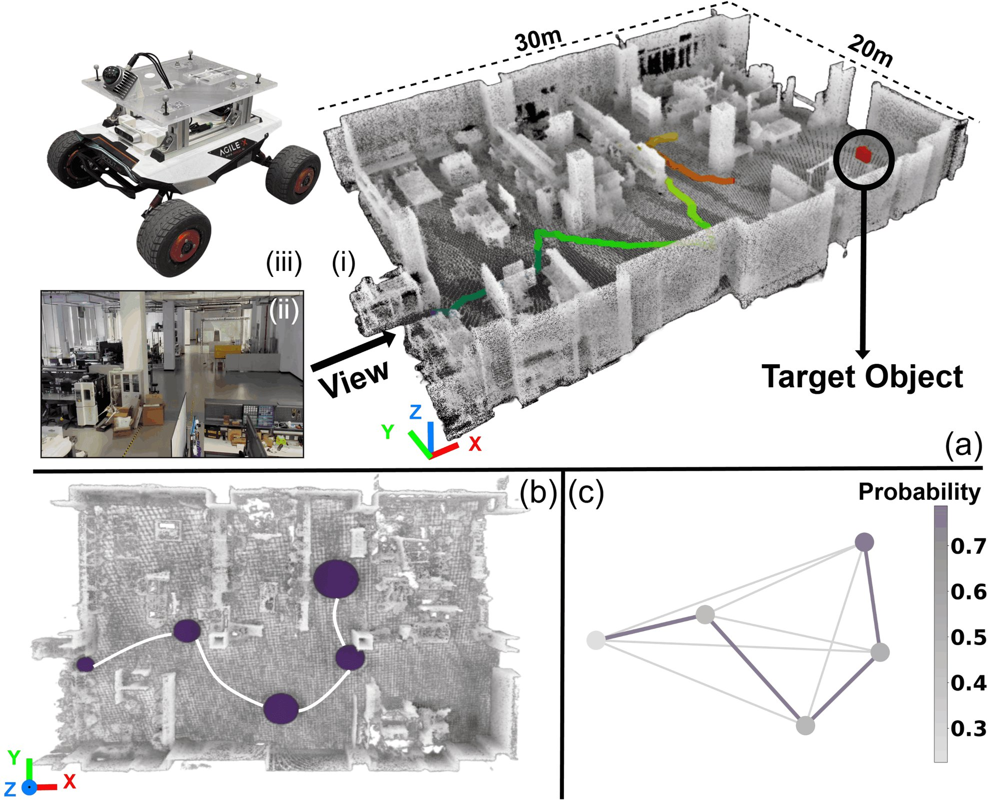

I received the B.S. degree in mechanical engineering from [Huazhong University of Science and Technology](https://www.hust.edu.cn/), Wuhan, China, in 2024. I am currently working toward the Ph.D. degree in control science and engineering with [Shanghai Jiao Tong University](https://www.sjtu.edu.cn/), Shanghai, China, advised by Professor [Zhongqiang Ren](https://wonderren.github.io/).

My research interests include **robotics**, **target search**, and **embodied artificial intelligence**, with a particular focus on:
- **Target Search & Autonomous Exploration**: Formulating and solving efficient global planning strategies for active target localization and unknown space exploration.
- **Probabilistic Routing & Global Planning**: Designing search-based path planning algorithms with theoretical optimality guarantees (such as the Hamiltonian Path Problem with Probabilistic Terminals).
- **Multi-Robot Systems**: Developing scalable, distributed coordination and planning frameworks for asynchronous multi-robot exploration under intermittent communication.

---

## News
* **[Jan. 2026]** Our paper **"RPT\*: Global Planning with Probabilistic Terminals for Target Search in Complex Environments"** has been published in **IEEE Transactions on Robotics (T-RO)**! [[IEEE Xplore]](https://ieeexplore.ieee.org/document/11769626) [[arXiv]](https://arxiv.org/abs/2601.12701)

---

## Selected Publications

  

* **RPT\*: Global Planning with Probabilistic Terminals for Target Search in Complex Environments**  
  **Yunpeng Lyu\***, Chao Cao\*, Ji Zhang, Howie Choset, Zhongqiang Ren (\*Equal contribution)  
  *IEEE Transactions on Robotics (T-RO)*, Regular Paper, 2026.  
  [[IEEE Xplore]](https://ieeexplore.ieee.org/document/11769626) | [[arXiv]](https://arxiv.org/abs/2601.12701) | [[Details]](/publication/2026-01-19-rpt-star)
