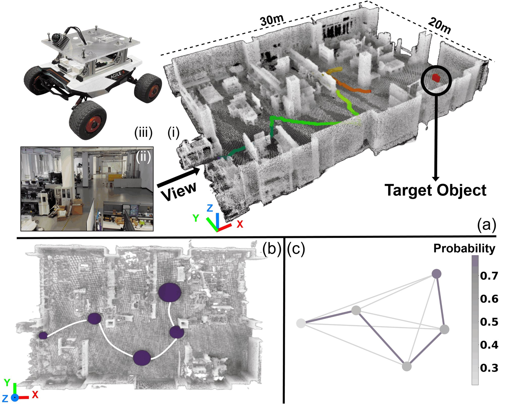

**Authors:** **Yunpeng Lyu***, Chao Cao*, Ji Zhang, Howie Choset, and Zhongqiang Ren (*Equal contribution)  
**Venue:** *IEEE Transactions on Robotics (T-RO)*, Regular Paper, 2026  
**Links:** [[IEEE Xplore (Official)]](https://ieeexplore.ieee.org/document/11769626) | [[arXiv:2601.12701]](https://arxiv.org/abs/2601.12701)

  
  
Figure: Real-world target search setup in a 30m &times; 20m complex environment, demonstrating global path planning with probabilistic terminals.

### Abstract
Routing problems such as the Hamiltonian Path Problem (HPP) seek a path to visit all vertices in a graph while minimizing path cost. This paper studies a variant, HPP with Probabilistic Terminals (HPP-PT), where each vertex has a probability representing the likelihood that the robot’s path terminates there, and the objective is to minimize the expected path cost. HPP-PT arises in target object search, where a mobile robot must visit candidate locations to find an object, and prior knowledge of the object’s location is expressed as vertex probabilities.

While routing problems have been studied for decades, few consider uncertainty as required in this work. The challenge lies not only in optimally ordering the vertices, as in standard HPP, but also in handling history dependency: the expected path cost depends on the order in which vertices were previously visited. This makes many existing methods inefficient or inapplicable.

To address the challenge, we propose a search-based approach **RPT\*** with solution optimality guarantees, which leverages dynamic programming in a new state space to bypass history dependency and novel heuristics to speed up computation. Building on RPT\*, we design a **Hierarchical Autonomous Target Search (HATS)** system that combines RPT\* with either Bayesian filtering for lifelong target search with noisy sensors, or autonomous exploration to find targets in unknown environments. Experiments in both simulation and real robots demonstrate that our approach naturally balances exploitation and exploration, finding targets faster on average than baseline methods.
